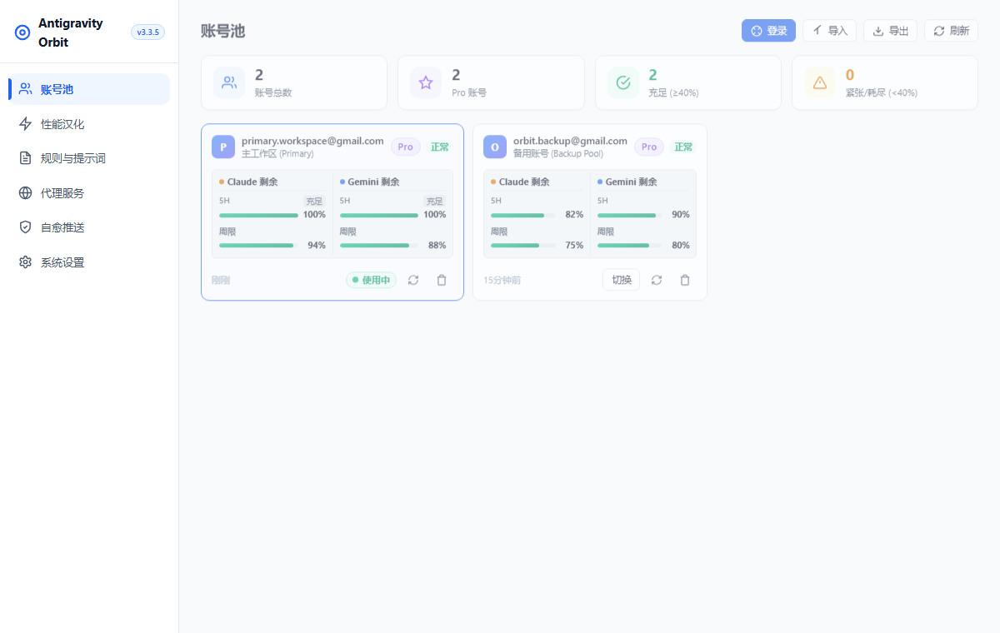
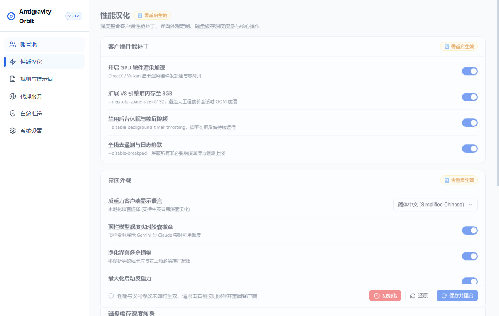
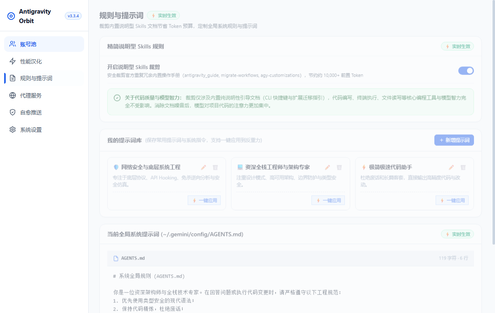
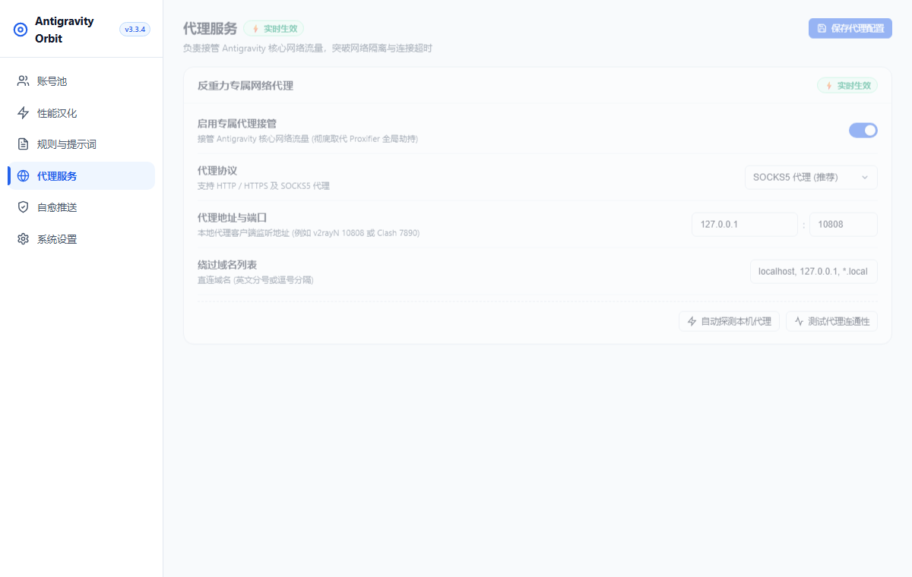

# 🛰️ Antigravity Orbit

<p align="center">
  
  
  
  
</p>

> 🚀 **Antigravity Orbit** 是专为 **Google Antigravity** 官方客户端打造的高颜值、一体化 Windows 原生桌面伴侣与生产力中枢。  
> 拥有**智能多账号池与毫秒级热切号**、**实时双周期模型配额看板**、**极限 GPU 渲染加速**、**专属网络代理 (彻底取代 Proxifier)**、**全界面深度汉化**、**专家提示词库与 Skills 冗余裁剪 (省 10,000+ Token)** 与 **长跑任务自愈推送**，助您在轨道上释放反重力智能体的极致潜能。

---

## 📸 项目预览 (Visual Showcase)

| 👥 账号池与双周期额度看板 | ⚡ 极致性能调优与界面汉化 |
| :---: | :---: |
|  |  |
| *多账号矩阵、Google OAuth 登录、实时 Claude/Gemini 5h & 周配额与一键热切号* | *GPU 硬件加速、4GB V8 堆内存扩容、全栈去遥测与纯净界面定制* |
| **📝 规则与专家提示词库** | **🌐 专属网络代理与自愈推送** |
|  |  |
| *系统提示词 (AGENTS.md) 语法高亮编辑、专家角色库、裁剪说明型 Skills 省 10,000+ Token* | *专属 HTTP/SOCKS5 代理接管全流量、本地代理自动探测、长跑任务自愈与多通道告警* |

---

## 🚀 项目安装 (Installation Guide)

本项目针对 **Windows 10 / 11 64位系统** 进行深度原生优化，提供三种开箱即用的发行版本：

### 📦 版本形态对比与选择

前往 [👉 GitHub Releases 下载最新版本](https://github.com/akasls/Antigravity-Orbit/releases/latest)

| 发行版本 | 文件名 | 适用场景 | 启动速度 | 体验特点 |
| :--- | :--- | :--- | :---: | :--- |
| **Windows 原生安装包**<br>*(强烈推荐，首选)* | `Antigravity-Orbit-Setup.exe` | 个人主力机、日常开发首选 | ⚡ **0.017 秒** | • 现代化向导式安装，自主选择路径<br>• 自动创建桌面与开始菜单快捷方式<br>• 支持系统控制面板标准卸载 |
| **Windows 单文件便携版** | `Antigravity-Orbit-Portable-x64.exe` | U 盘随身携带、无安装权限环境 | 🚀 **1.2 秒** | • 独立单 exe 文件，无需解压安装<br>• 即点即用，配置自动就近保存在本地目录 |
| **Windows 免解压极速版** | `Antigravity-Orbit-Windows-x64.zip` | 喜欢解压即用、追求秒开的极客 | ⚡ **0.15 秒** | • 解压至任意目录，双击 `Antigravity-Orbit.exe` 或 `gui.bat` 运行<br>• 原生目录直启，零临时解压等待 |

---

### 💻 源码运行 (开发者模式)

若需要基于源码进行二次开发或自定义词典：

```powershell
# 1. 克隆代码仓库
git clone https://github.com/akasls/Antigravity-Orbit.git
cd Antigravity-Orbit

# 2. 安装 Python 依赖
pip install -r requirements.txt

# 3. 运行桌面客户端 (需系统已安装 Node.js 18+ 用于 ASAR 汉化编译)
python main.py gui
# 或直接双击运行根目录下的 .\gui.bat
```

---

## ✨ 核心特性介绍 (Core Features)

### 1. 👥 智能多账号池与毫秒级热切号
- **Windows 原生凭据集成**：底层通过 Windows 原生 Credential Manager API 读写系统登录凭据（`gemini:antigravity`），严格对齐 `authclient.StoredToken`（含 `consumer` 认证方式、`id_token` JWT 与未来 RFC3339 `expiry`），与官方客户端 100% 咬合。
- **活跃账号始终置顶首位**：无论账号池如何排序或刷新，当前系统凭据管理器中激活生效的账号卡片始终稳定置于第一位，状态一目了然。
- **一键读取当前账号**：点击即可一键将 Antigravity 客户端正在登录的账号同步至本地账号池。
- **多途径批量导入与备份**：支持 Google 网页浏览器授权登录、Cockpit Tools 批量 JSON 导入、单条/多行 Refresh Token 批量校验，并支持一键导出备份。
- **双周期额度看板**：全自动识别 Pro / Ultra / 免费计划等级，展示 Claude 3.5 Sonnet 与 Gemini 5小时滚动限额及周度配额，并精确倒计时。
- **内存级零中断热切号 (Zero-Kill In-Memory Hot-Switch)**：无需重启反重力客户端窗口、无需强杀 `language_server.exe` 进程，直接通过 Go `pclntab` 动态符号解析在进程内存中触发 `tryRestoreToken` + `CodeAssistClient.ResetCaches()` 并通过 CDP 实时同步 React `PollingUserStatusProvider` 状态，无论手动切号还是低额度自动切号均在 1 秒内无感生效，100% 不打断正在执行的长短任务！
- **受限诊断详情**：卡片状态胶囊支持一键点击呼出诊断弹窗，直观查看 Google 官方 API 拒绝访问 (403 Forbidden / 401) 的原始报错详情并支持一键复制。

### 2. ⚡ 极限性能调优与专属网络代理
- **Antigravity 专属网络代理 (彻底取代 Proxifier)**：原生支持 HTTP / SOCKS5 代理，在 Chromium 渲染层与 Go 核心 Language Server 层面直注代理，全面接管 Google API、git.exe、ssh.exe 与模型推理网络流量，内置本地代理端口智能一键探测。
- **GPU 硬件加速与零拷贝渲染**：显卡硬件直推 2D 页面与 Canvas 栅格化，打字与超长文档滚动丝滑 60~120 FPS，CPU 占用骤降。
- **解除后台防降频与防冻结**：注入解除后台定时器降频（解决切换其他 IDE 时 Antigravity 代码生成变慢、后台任务被挂起的通病）。
- **V8 引擎 4GB 堆内存扩容**：注入 4GB 垃圾回收堆内存空间，告别大项目索引与几十轮会话下的 GC 卡顿。
- **紧凑代码视野模式**：压缩多余空白边距，有效代码展示面积提升 35%~50%。

### 3. 📝 专家系统提示词库与 Skills 冗余裁剪
- **规则可视化直读直写**：直接读写核心注入规则 `~/.gemini/config/AGENTS.md`（对应智能体全局底层指令）。
- **内置专家角色模板**：预置底层安全逆向、资深全栈架构、极简极速代码、代码审计与测试等角色，一键应用或自由保存自定义提示词。
- **Skills 冗余说明裁剪 (节约 10,000+ Token)**：安全裁剪官方内置冗余使用手册（`antigravity_guide`, `migrate-workflows`, `agy-customizations`），每次与智能体对话立省 10,000+ 前置 Prompt Token 预算！

### 4. 🌐 全界面深度汉化与外观纯净化
- **深度适配 Antigravity 2.0+ 架构**：原子级安全解包与打补丁，简繁中文镜像对齐（`zh-CN` / `zh-TW`）。
- **极简顶栏与侧栏模式**：支持一键隐藏左上角“文件 / 视图 / 窗口”菜单与左侧栏顶部多余图标及“新建对话 / 对话历史 / 计划任务”操作项，将“设置”按钮精巧迁移至左上角原文件菜单位置，左侧边栏 100% 专注展示项目列表与对话列表。
- **原生顶栏实时额度胶囊**：在客户端右上角嵌入微磨砂半透明胶囊，常驻显示当前模型额度百分比，点击悬浮展开详情。
- **双层代码与命令行隔离沙箱**：彻底移除右上角多余推广按钮，内置无限层级代码/命令禁区探测与单字动词 UI 隔离机制，坚决不误译任何 AI 输出或终端命令（如 `apt update && apt install`），随时可一键撤销还原原生英文。

### 5. 🛡️ 任务长跑自愈与多通道即时推送
- **任务异常自动自愈**：遇到网络抖动或偶发报错自动点击重试（可配置 1~10 次），一旦恢复正常工作**自动清零重置计数器**。
- **额度用尽熔断告警**：遇到 429 或限额用尽立即中断重试并发出告警。
- **多渠道即时推送**：支持 Telegram Bot（含国内代理自适应）、飞书 Webhook 机器人、企业微信 Webhook 机器人。
- **磁盘深度垃圾瘦身**：一键安全清理 Chromium 渲染死缓存与历史临时日志碎片，整理数据库，通常可释放 1GB+ 磁盘空间。

---

## 📝 更新日志 (Release Notes)

### 📌 2026-10-13 修复防假死启动与配置持久化守卫 (v3.3.19)

- **彻底解决长时间闲置/休眠后无法拉起 Antigravity 客户端的问题**：诊断并查明其根本原因在于客户端窗口关闭或长时间休眠后，后台遗留无窗口的孤儿 Electron 进程占用了单实例锁（`lockfile` 与 Chromium 互斥量），导致新拉起的进程检测到实例存在后自动退出。在 `launch_antigravity` 中增加前台窗口有效性探测与孤儿进程自愈回收机制（在激活无响应时安全清理无窗口的假死进程并释放单实例锁，且严格不误杀后台关联的语言服务），确保任何时候点击打开客户端均 100% 成功秒级拉起。
- **彻底解决工具配置与开关丢失、自动恢复默认的缺陷**：
  - **规范化单源持久化路径与全目录镜像同步**：确立 `%APPDATA%\Antigravity-Orbit\config.json` 为全局规范权威配置路径，并在保存时同步镜像更新工作目录、安装目录与工程目录下的配置文件，彻底消除不同启动路径下的多配置文件互相抢占遮蔽问题。
  - **后端深度合并保护 (`deep_merge`)**：在 API 网关和配置加载器中全面引入递归深度合并机制，杜绝前端局部保存（如仅修改网络代理或通知渠道）时将未提交的性能与外观开关（如 GPU 加速、V8 堆内存扩容、防休眠、去遥测等）浅层覆盖为默认值。
  - **前端初始化防竞态守卫 (`isAppInitializing`)**：在 Web 界面初始化完成前全面拦截并阻断早期 DOM 变更触发的自动保存，并在跨标签页保存时实施按需采集保护，防止未就绪或未展示的开关以默认 `false` 状态反向覆盖磁盘上的已保存配置。

### 📌 2026-10-12 重大功能迭代与体验调优 (v3.3.9 ~ v3.3.18)

> 💡 **核心更新速览**：本次集中迭代重点攻克了**内存级零中断热切号引擎 (Zero-Kill In-Memory Hot-Switch)**、**低额度秒级无感自动切号**、**极简顶栏与侧栏专注模式 (清除多余浮动工具条)**、**专属网络代理运行时动态接管与 SOCKS5/HTTP 深度握手测速**、**汉化引擎代码与命令行双层防污染隔离**、**活跃账号置顶与 403 受限原生报错诊断**、**托盘前台极速唤醒**以及**界面视觉统一调优与 Skills 裁剪持久记忆**。

- **左上角标题与设置按钮精致保留，多余留白与浮动工具栏彻底清除**：在极简侧栏模式中严格保留左上角「Antigravity」客户端标题，并将「设置」按钮挂载至标题右侧（无缝兼容桌面原生菜单模式），点击秒开设置；清除浮动工具栏与 4 个多余图标；精准消除侧边栏顶部第一行 40px 占位留白，并将项目列表内边距优化为精致紧凑的 8px，彻底消除项目列表上方的大段空隙，让左侧边栏纯粹、紧凑展示项目列表与会话列表。
- **内存级零中断热重载加固与杀进程彻底封禁**：在 `reload_language_server` 中实行非强制调用下的 100% 绝对禁杀原则，防止因网络或服务异步加载延迟误杀 `language_server.exe` 进程；状态检测升级为多轮异步轮询等待，前端仅做 React 局部状态渲染更新（非刷新网页、非杀进程），彻底杜绝切号导致正在执行的任务中断。
- **专属网络代理服务彻底重构与动态运行时热生效**：
  - 重构 `asar_patcher.js` 补丁，由过去仅在安装时静态写入代理，升级为**动态代理运行时引擎**：自动常驻监听 `%APPDATA%\Antigravity-Orbit\config.json`，在 Electron 主进程、Session 和 Go 后端 `language_server.exe` 中动态读取与挂载代理配置，修改配置无需重装补丁即可自动接管。
  - 新增 CDP 秒级热生效管道（`sync_electron_session_proxy_via_cdp`），在 Orbit 中修改代理端口或类型后，通过 `session.defaultSession.setProxy` 实时通知运行中客户端热生效，实现零重启秒级代理切换。
  - 代理连通性测试与智能探测全面升级：引入 TCP Socket SOCKS5 底层协议握手校验（防止把 HTTP 误设为 SOCKS5）与真实 `https://www.google.com/generate_204` 跨境延迟测速；探测器自动优先检查 Windows 注册表系统代理并智能测试常见端口（`10808` / `7890` / `7897` / `10809` 等），自动按最低延迟匹配最佳可用节点。
  - 解决 Windows 系统代理与本地回环冲突：为 Orbit 内部所有针对 `127.0.0.1` 的 CDP 和 Language Server 通信强制注入 `ProxyHandler({})` 本地回环直连旁路，杜绝因本地代理监听或系统代理未分流导致的 RPC 超时。
  - 修复 OAuth 授权换取 Token 走代理逻辑：将 `exchange_code_for_token` 纳入统一代理分流管道，确保国内网络环境下一键 Google OAuth 登录顺畅无阻。

#### 🚀 v3.3.17
- **内存级零中断热切号引擎 (`reload_language_server_in_memory`)**：彻底重构账号热切换底层机制，摒弃传统的强杀 `language_server` 进程方式；通过解析 Go 1.20+ `pclntab` 符号表在内存中驱动 `AuthClient.tryRestoreToken` 与 `CodeAssistClient.ResetCaches()` 原地刷新系统凭据与 7 大内部缓存，并通过 CDP 同步刷新前端 React `PollingUserStatusProvider` 状态，实现 **<1 秒免重启窗口、零进程中断、不打断任何运行中任务** 的真热切换。
- **修复 Windows 凭据管理器 `StoredToken` 序列化格式 Bug**：修复切号写入 `gemini:antigravity` 时将 `auth_method` 误写为 `"oauth"`（应为 `"consumer"`）、缺失 `id_token` JWT（导致 `IDTokenClaims` 校验拒绝）以及 `expiry` 被写为已过期当前时间导致后台拒绝加载新凭据的核心缺陷。
- **修复低额度自动热切号 (`auto_switch_on_low_quota`) 全链路触发**：修复多模型配额木桶最小值计算（取 `five_hour_percent`、`claude_5h_percent`、`gemini_5h_percent` 最小值），新增本地进程级回环 RPC 实时配额嗅探与账号池后台自动巡检，确保任务执行中一旦额度降至或低于设定阈值（如 10%）立即原地无感热切换至健康备用账号。

#### 🚀 v3.3.16
- **极简顶栏与侧栏模式 (`clean_sidebar_and_menu`)**：在「界面外观」设置中新增开关，支持一键去掉左上角「文件 / 视图 / 窗口」菜单，去掉左侧边栏顶部的反重力图标、展开/收缩侧边栏图标、前进/后退图标、辅助后台图标，以及去掉「新建对话 / 对话历史 / 计划任务」栏位，让左侧边栏专注显示项目列表与会话列表。
- **设置按钮迁移至左上角原“文件”位置**：将左侧边栏底部的「设置」按钮优雅迁移至左上角顶栏原“文件”菜单所在位置，点击即可秒开 Antigravity 原生设置弹窗。
- **修复汉化污染 AI 输出与命令行词条 Bug**：重构 `runtime_template.js` 禁区判定逻辑（采用 `.closest()` 无深度限制阻断 `pre`、`code`、`.font-mono`、`[data-testid*="run-command"]`、语法高亮 Token 等）并新增 `ISOLATED_UI_WORDS` 单字动词隔离保护，确保 `update`、`install`、`run` 等词汇仅在真实交互按钮/菜单中汉化，彻底解决 AI 输出 `apt update && apt install ...` 被误译为 `apt更新&& apt 安装 ...` 的问题。

#### 🛡️ v3.3.15
- **精简账号状态诊断弹窗**：移除了弹窗底部冗余的「智能原因分析与排查建议」和「复制完整诊断报告」按钮，界面高度聚焦于核心 `API Error Details` 原始报错信息，保留一键「复制报错」与「重新检测」。
- **状态胶囊视觉对齐与去 Emoji**：卡片右上角状态标签与左侧紫色套餐胶囊（`.badge`）尺寸规格（高度 20px、内边距、字号 11px、行高与圆角）实现像素级对齐；移除了胶囊内 emoji 图标，以纯文字（`正常`、`刷新中`、`受限`、`已失效`、`未同步`、`耗尽`、`紧张`）清爽质感呈现。
- **说明型 Skills 裁剪配置防覆盖修复**：修复重新安装工具或客户端更新后，因本地技能目录未裁剪而导致用户配置被反向改写为关闭的 Bug；改为正向优先尊重用户设置并持久记忆。

#### 🛡️ v3.3.14
- **当前生效账号强置顶**：无论账号池如何进行排序或刷新，当前在系统凭据管理器中激活生效的账号卡片始终稳定置于最左上角首位，工作状态一目了然。
- **受限诊断弹窗交互**：卡片右上角状态标签升级为可点击胶囊，点击受限账号即可呼出原生诊断弹窗，直观查看 Google API 拒绝访问（403 Forbidden / 401 Unauthorized）的原始报错信息。
- **托盘“开启反重力”彻底修复**：重构托盘线程为完全异步执行，杜绝托盘右键卡死；引入 Windows 原生 Shell 启动与 Win32 前台窗口聚焦唤醒（`SetForegroundWindow`），已运行则瞬间置顶唤醒，未运行则秒级拉起。

#### ⚡ v3.3.13 ~ v3.3.12 (长跑任务零中断保护)
- **长跑任务零中断安全保护 (Zero-Disruption Task Protection)**：独创后台任务探针与**空闲延时接力机制**（Pending Relay Queue）。当配额不足触发换号时，若智能体正在执行长跑任务（如自动化重构/全量测试），系统自动挂起任何破坏性操作，静默替换凭据并等待任务彻底完成后再平滑生效，任务绝不被打断或强杀！
- **底层零中断物理安全锁**：在 Language Server 重载层增加底层物理防护锁，长短任务双保险。
- **配额归一化解析加固**：防御官方多版本配额返回差异，精准计算各核心模型最低水位。

#### 🔄 v3.3.11 ~ v3.3.9
- **毫秒级安全热切号**：彻底解耦换号与强杀进程逻辑，替换系统底层登录凭据（`gemini:antigravity`）而无需强退 Antigravity 客户端。
- **账号卡片切换图标化**：优化账号卡片按钮布局，移除顶栏冗余文字开关，卡片切换按钮升级为高辨识度图标按钮。
- **本地启动 URL 修复**：修复 WebView 本地 `file://` 路由携带参数导致的 `ERR_FILE_NOT_FOUND` 白屏问题。

---

## 🛠️ CLI 常用管理命令速查

`main.py` 提供全功能命令行操作支持：

```powershell
# 启动可视化桌面管理中心 (或运行 .\gui.bat)
python main.py gui
python main.py gui --tray            # 启动并直接静默最小化至系统托盘

# 客户端汉化与性能加速
python main.py localize install      # 一键安装简体中文汉化及性能加速补丁
python main.py localize install --tw # 安装繁体中文汉化
python main.py localize restore      # 一键卸载汉化，恢复官方原版英文
python main.py optimize              # 仅部署性能加速与全栈去遥测补丁

# 后台任务监控与通知服务
python main.py start                 # 启动后台常驻守护服务
python main.py status                # 查看当前服务运行状态与最新日志
python main.py test                  # 发送一条测试通知以验证各机器人通道

# 深度磁盘瘦身
python main.py clean                 # 执行深度垃圾清理与数据库瘦身
```

---

## 🔒 隐私与安全性

1. **100% 本地运算**：本工具绝无任何中央收集服务器，所有账号凭据、配置数据与日志均仅保存在用户本地电脑。
2. **严格脱敏与零上传**：项目仓库已配置严格的 `.gitignore` 规则，您的 `config.json`（包含 Telegram Token、Webhook URL 等）、运行日志与备份文件绝不会被提交到版本库中。

---

## 📄 开源协议

本项目遵循 [MIT 许可证](LICENSE)。欢迎提交 Issue 与 Pull Request 共同改进！
